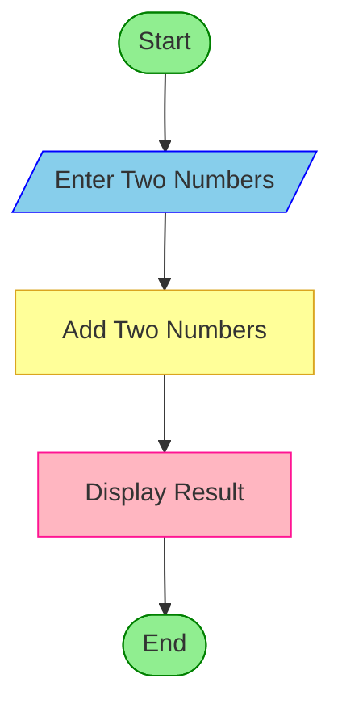

# Integrated Campus Energy and Water Audit

## 1. Problem Statement

Develop a Python program to analyse electricity and water consumption across multiple campus buildings over several days. The program should calculate the total consumption and cost for each building, determine the percentage change between the first and last day, identify buildings with excessive consumption, and rank buildings using a specified scoring method.

The program uses lists, nested lists, loops, conditional statements, and arithmetic operations to generate an energy and water audit report.

Assumptions used in this program:

- Electricity cost = ₹8 per unit (kWh).
- Water cost = ₹30 per kilolitre (kL).
- Excessive consumption is identified when the average daily usage exceeds the specified limits.
- Building score = 60% electricity usage score + 40% water usage score, with lower consumption receiving a better rank.

## 2. Algorithm

1. Start the program.
2. Read the number of buildings and the number of days.
3. Input the building names and daily electricity and water consumption.
4. Calculate the total and average consumption for each building.
5. Calculate electricity cost, water cost, and total cost.
6. Calculate the percentage change from the first day to the last day.
7. Check whether electricity or water consumption exceeds the specified limits.
8. Calculate a combined score for each building using electricity and water consumption.
9. Rank buildings from lowest to highest score.
10. Display consumption, costs, percentage changes, excessive consumption warnings, and rankings.
11. Stop the program.

## 3. Flowchart (Mermaid TD)

## 4. Python Source Code

```
    name = input("\nEnter building name: ")    electricity = []    water = []    for d in range(days):        e = float(input(            f"Day {d + 1} electricity (kWh): "        ))        w = float(input(            f"Day {d + 1} water (kL): "        ))        if e < 0 or w < 0:            print("Consumption cannot be negative.")            raise SystemExit        electricity.append(e)        water.append(w)    total_e = sum(electricity)    total_w = sum(water)    avg_e = total_e / days    avg_w = total_w / days    electricity_cost = total_e * ELECTRICITY_RATE    water_cost = total_w * WATER_RATE    total_cost = electricity_cost + water_cost    if electricity[0] != 0:        e_change = (            (electricity[-1] - electricity[0])            / electricity[0]        ) * 100    else:        e_change = 0 if electricity[-1] == 0 else None    if water[0] != 0:        w_change = (            (water[-1] - water[0]) / water[0]        ) * 100    else:        w_change = 0 if water[-1] == 0 else None    excessive = []    if avg_e > ELECTRICITY_LIMIT:        excessive.append("Electricity")    if avg_w > WATER_LIMIT:        excessive.append("Water")    # Lower consumption gives a lower score.    # Score = 60% electricity + 40% water.    score = (0.6 * avg_e / ELECTRICITY_LIMIT             + 0.4 * avg_w / WATER_LIMIT) * 100    buildings.append({        "name": name,        "total_e": total_e,        "total_w": total_w,        "avg_e": avg_e,        "avg_w": avg_w,        "electricity_cost": electricity_cost,        "water_cost": water_cost,        "total_cost": total_cost,        "e_change": e_change,        "w_change": w_change,        "excessive": excessive,        "score": score    })# Display individual building reportsprint("\n========== CAMPUS AUDIT REPORT ==========")
```

## 5. Sample Input

For this example, enter the following values in the same order as the program prompts.

```

Enter number of buildings: 3
Enter number of days: 2

Enter building name: Library
Day 1 electricity (kWh): 80
Day 1 water (kL): 5
Day 2 electricity (kWh): 90
Day 2 water (kL): 6

Enter building name: Laboratory
Day 1 electricity (kWh): 120
Day 1 water (kL): 12
Day 2 electricity (kWh): 140
Day 2 water (kL): 14

Enter building name: Hostel
Day 1 electricity (kWh): 100
Day 1 water (kL): 8
Day 2 electricity (kWh): 110
Day 2 water (kL): 9

```

## 6. Sample Output

```

========== CAMPUS AUDIT REPORT ==========

Building: Library
Total electricity: 170.00 kWh
Total water: 11.00 kL
Average electricity: 85.00 kWh/day
Average water: 5.50 kL/day
Electricity cost: Rs. 1360.00
Water cost: Rs. 330.00
Total cost: Rs. 1690.00
Electricity percentage change: 12.50%
Water percentage change: 20.00%
Consumption status: Normal
Combined score: 73.00

Building: Laboratory
Total electricity: 260.00 kWh
Total water: 26.00 kL
Average electricity: 130.00 kWh/day
Average water: 13.00 kL/day
Electricity cost: Rs. 2080.00
Water cost: Rs. 780.00
Total cost: Rs. 2860.00
Electricity percentage change: 16.67%
Water percentage change: 16.67%
Warning: Excessive Electricity, Water
Combined score: 130.00

Building: Hostel
Total electricity: 210.00 kWh
Total water: 17.00 kL
Average electricity: 105.00 kWh/day
Average water: 8.50 kL/day
Electricity cost: Rs. 1680.00
Water cost: Rs. 510.00
Total cost: Rs. 2190.00
Electricity percentage change: 10.00%
Water percentage change: 12.50%
Warning: Excessive Electricity
Combined score: 105.00

========== BUILDING RANKING ==========
1. Library - Score: 73.00
2. Hostel - Score: 105.00
3. Laboratory - Score: 130.00

========== CAMPUS TOTALS ==========
Total electricity: 640.00 kWh
Total water: 54.00 kL
Total expenditure: Rs. 6740.00

```

## 7. Result

The program successfully calculates electricity and water consumption, estimates costs, measures percentage changes, identifies excessive consumption, and ranks campus buildings. In this example, Library ranks first, while Laboratory requires attention because both its electricity and water usage exceed the defined limits.
