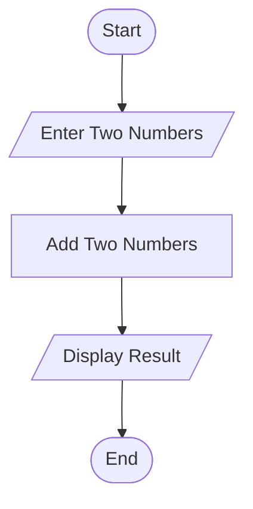

# Smart Public Transport Fare Reconciliation

## 1. Problem Statement

Develop a Python program to calculate passenger fares across multiple public transport routes and passenger categories. The program should apply route-based fares, passenger-category concessions, and ticket quantities to calculate the expected revenue. It should then compare expected revenue with the actual collected revenue, identify discrepancies, and generate a reconciliation report for each route.

Assumptions used:

- Adult passengers pay the full route fare.
- Student passengers receive a 25% discount.
- Senior citizens receive a 40% discount.
- Expected revenue is calculated using the discounted fares and number of tickets sold.
- Discrepancy = Collected revenue − Expected revenue.
- A positive discrepancy indicates excess collection; a negative discrepancy indicates a shortage.

## 2. Algorithm

1. Start the program.
2. Input the number of transport routes.
3. For each route, input the route name and base fare.
4. Input the number of adult, student, and senior citizen tickets sold.
5. Calculate the fare for each passenger category after applying discounts.
6. Calculate expected revenue for the route.
7. Input the actual collected revenue.
8. Calculate the discrepancy between collected and expected revenue.
9. Classify the discrepancy as excess collection, revenue shortage, or exact match.
10. Calculate total expected revenue, total collected revenue, and overall discrepancy.
11. Display the route-wise reconciliation report.
12. Stop the program.

## 3. Flowchart (Mermaid TD)

## 4. Python Source Code

```
    if base_fare < 0:        print("Fare cannot be negative.")        raise SystemExit    adults = int(input("Enter adult tickets sold: "))    students = int(input("Enter student tickets sold: "))    seniors = int(input("Enter senior citizen tickets sold: "))    if adults < 0 or students < 0 or seniors < 0:        print("Ticket quantities cannot be negative.")        raise SystemExit    collected = float(        input("Enter actual collected revenue: Rs. ")    )    if collected < 0:        print("Revenue cannot be negative.")        raise SystemExit    # Calculate discounted fares    adult_fare = base_fare    student_fare = base_fare * (1 - STUDENT_DISCOUNT)    senior_fare = base_fare * (1 - SENIOR_DISCOUNT)    # Calculate expected revenue    adult_revenue = adults * adult_fare    student_revenue = students * student_fare    senior_revenue = seniors * senior_fare    expected = (        adult_revenue + student_revenue + senior_revenue    )    # Reconcile revenue    discrepancy = collected - expected    if discrepancy > 0:        status = "Excess collection"    elif discrepancy < 0:        status = "Revenue shortage"    else:        status = "Exact match"    routes.append({        "name": route_name,        "adults": adults,        "students": students,        "seniors": seniors,        "expected": expected,        "collected": collected,        "discrepancy": discrepancy,        "status": status    })# Display route-wise reportprint("\n===== FARE RECONCILIATION REPORT =====")for route in routes:    print(f"\nRoute: {route['name']}")    print(f"Adult tickets: {route['adults']}")    print(f"Student tickets: {route['students']}")    print(f"Senior citizen tickets: {route['seniors']}")    print(f"Expected revenue: Rs. {route['expected']:.2f}")    print(f"Collected revenue: Rs. {route['collected']:.2f}")    print(f"Discrepancy: Rs. {route['discrepancy']:.2f}")    print(f"Status: {route['status']}")
```

## 5. Sample Input

```

Enter number of routes: 2

Route 1
Enter route name: City-A
Enter base fare: Rs. 40
Enter adult tickets sold: 10
Enter student tickets sold: 4
Enter senior citizen tickets sold: 2
Enter actual collected revenue: Rs. 560

Route 2
Enter route name: City-B
Enter base fare: Rs. 60
Enter adult tickets sold: 8
Enter student tickets sold: 5
Enter senior citizen tickets sold: 3
Enter actual collected revenue: Rs. 830

```

## 6. Sample Output

```

===== FARE RECONCILIATION REPORT =====

Route: City-A
Adult tickets: 10
Student tickets: 4
Senior citizen tickets: 2
Expected revenue: Rs. 568.00
Collected revenue: Rs. 560.00
Discrepancy: Rs. -8.00
Status: Revenue shortage

Route: City-B
Adult tickets: 8
Student tickets: 5
Senior citizen tickets: 3
Expected revenue: Rs. 813.00
Collected revenue: Rs. 830.00
Discrepancy: Rs. 17.00
Status: Excess collection

===== OVERALL SUMMARY =====
Total expected revenue: Rs. 1381.00
Total collected revenue: Rs. 1390.00
Overall discrepancy: Rs. 9.00
Overall status: Excess collection

```

## 7. Result

The program calculates passenger fares using category-based discounts, determines expected revenue for each route, compares it with actual collections, and identifies revenue shortages or excess collections. The overall reconciliation report helps transport authorities monitor fare collection and detect discrepancies.
