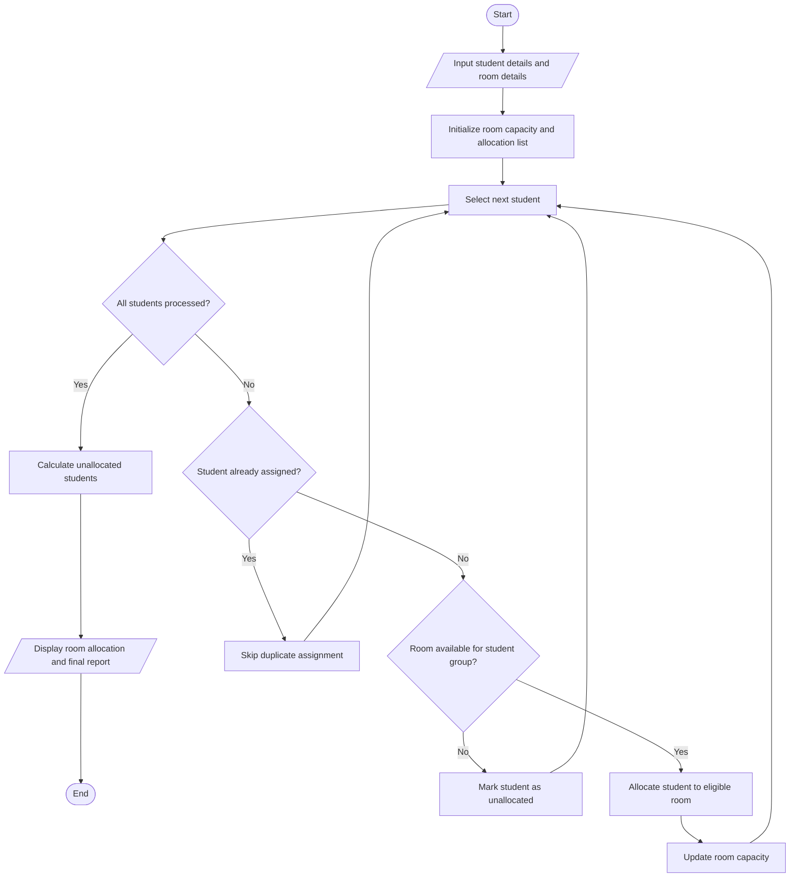

# University Hostel Room Allocation

## 1. Problem Statement

Develop a Python program to allocate students to university hostel rooms based on room capacity, student eligibility, and grouping constraints. The program should check whether students meet the eligibility requirements for each room, prevent room capacity from being exceeded, detect duplicate student assignments, and calculate the number of students who remain unallocated.

Assumptions used:

- Each student has a unique student ID and a group (A or B).
- Each room has a fixed capacity and an eligible group.
- Students can be assigned only to rooms matching their group.
- A student must not be assigned to more than one room.
- Students are allocated in input order until eligible rooms have no remaining capacity.

## 2. Algorithm

1. Start the program.
2. Input the number of students and their IDs and groups.
3. Input the number of rooms, their capacities, and eligible groups.
4. Check for duplicate student IDs.
5. Allocate each student to the first eligible room with available capacity.
6. Prevent duplicate assignments and reject ineligible allocations.
7. Record students who cannot be allocated.
8. Calculate the remaining capacity of each room and total unallocated demand.
9. Display room-wise assignments, duplicate records, and unallocated students.
10. Stop the program.

## 3. Flowchart (Mermaid TD)

## 4. Python Source Code

```
# University Hostel Room Allocationstudents = []rooms = []duplicate_ids = []n = int(input("Enter number of students: "))if n < 0:    print("Invalid number of students.")    raise SystemExit# Input student informationfor i in range(n):    print(f"\nStudent {i + 1}")    sid = input("Enter student ID: ").strip()    group = input("Enter group (A/B): ").strip().upper()    if group not in ("A", "B"):        print("Invalid group. Enter A or B.")        raise SystemExit    if any(s["id"] == sid for s in students):        duplicate_ids.append(sid)        print("Duplicate ID detected. Student not added.")        continue    students.append({        "id": sid,        "group": group    })# Input room informationr = int(input("\nEnter number of rooms: "))
```

## 5. Sample Input

```

Enter number of students: 5

Student 1
Enter student ID: S101
Enter group (A/B): A

Student 2
Enter student ID: S102
Enter group (A/B): B

Student 3
Enter student ID: S103
Enter group (A/B): A

Student 4
Enter student ID: S102
Enter group (A/B): B
Duplicate ID detected. Student not added.

Student 5
Enter student ID: S104
Enter group (A/B): B

Enter number of rooms: 2

Room 1
Enter room name: Room-A
Enter room capacity: 2
Enter eligible group (A/B): A

Room 2
Enter room name: Room-B
Enter room capacity: 1
Enter eligible group (A/B): B

```

## 6. Sample Output

```

===== HOSTEL ALLOCATION REPORT =====

Room: Room-A
Eligible group: A
Capacity: 2
Allocated students: ['S101', 'S103']
Students allocated: 2
Vacant beds: 0

Room: Room-B
Eligible group: B
Capacity: 1
Allocated students: ['S102']
Students allocated: 1
Vacant beds: 0

===== DUPLICATE STUDENT IDS =====
S102

===== UNALLOCATED STUDENTS =====
S104
Total valid students: 4
Total allocated: 3
Unallocated demand: 1
Total vacant beds: 0

```

## 7. Result

The program allocates students according to room capacity and group eligibility, detects duplicate student IDs, and identifies students who could not be accommodated. In this example, three students are allocated, one student remains unallocated, and one duplicate ID is detected.
