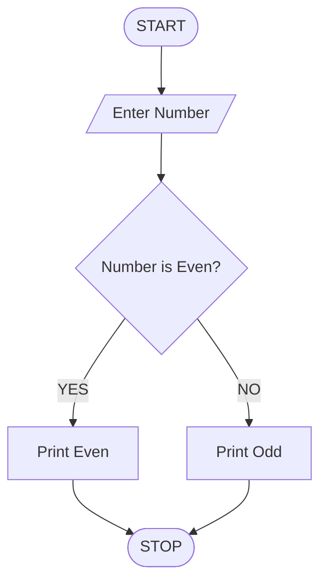

# Multi-Branch Retail Inventory Transfer

## 1. Problem Statement

Develop a Python program to manage inventory transfers between multiple retail branches. The program should compare each branch's current stock with its target stock level, calculate surplus and shortage quantities for each product, and generate stock transfer recommendations.

The program must respect transfer constraints, including the maximum quantity transferable per transaction and the requirement that a branch cannot transfer more stock than its available surplus. It should update stock levels after transfers and display any remaining shortages.

Assumptions used:

- All branches maintain the same list of products.
- A branch with stock above its target can supply branches with shortages.
- Transfers are made only between different branches for the same product.
- Each transfer is limited by a user-specified maximum quantity.
- Stock is never allowed to become negative.
- Remaining shortages are reported when available surplus cannot meet demand.

## 2. Algorithm

1. Start the program.
2. Input the number of branches, products, and maximum transfer quantity.
3. Enter the current stock and target stock for each product at every branch.
4. Calculate the surplus or shortage for each branch and product.
5. Identify branches with surplus stock and branches with shortages.
6. Select a donor branch and a recipient branch for the same product.
7. Transfer the minimum of available surplus, remaining shortage, and maximum transfer quantity.
8. Repeat transfers until no further transfers are possible.
9. Update stock levels and calculate remaining shortages.
10. Display surplus, shortage, transfer details, and final stock levels.
11. Stop the program.

## 3. Flowchart (Mermaid TD)

## 4. Python Source Code

```
# Multi-Branch Retail Inventory Transferbranches = []products = []n = int(input("Enter number of branches: "))p = int(input("Enter number of products: "))max_transfer = int(input("Enter maximum quantity per transfer: "))if n <= 0 or p <= 0 or max_transfer <= 0:    print("Invalid input.")    raise SystemExit# Input product namesfor i in range(p):    product = input(f"Enter product {i + 1} name: ")    products.append(product)# Input branch stock and target levelsfor i in range(n):    name = input(f"\nEnter branch {i + 1} name: ")    stock = []    target = []    for product in products:        current = int(input(f"{product} current stock: "))        required = int(input(f"{product} target stock: "))        if current < 0 or required < 0:            print("Stock and target values cannot be negative.")            raise SystemExit        stock.append(current)        target.append(required)
```

## 5. Sample Input

```

Enter number of branches: 2
Enter number of products: 2
Enter maximum quantity per transfer: 4
Enter product 1 name: Pen
Enter product 2 name: Notebook

Enter branch 1 name: Branch-A
Pen current stock: 20
Pen target stock: 10
Notebook current stock: 5
Notebook target stock: 10

Enter branch 2 name: Branch-B
Pen current stock: 3
Pen target stock: 8
Notebook current stock: 20
Notebook target stock: 15

```

## 6. Sample Output

```

===== INITIAL INVENTORY ANALYSIS =====

Branch: Branch-A
Pen: Surplus = 5, Shortage = 0
Notebook: Surplus = 0, Shortage = 5

Branch: Branch-B
Pen: Surplus = 0, Shortage = 0
Notebook: Surplus = 5, Shortage = 0

===== TRANSFER PLAN =====
Pen: 4 units from Branch-A to Branch-B
Pen: 1 units from Branch-A to Branch-B
Notebook: 4 units from Branch-B to Branch-A
Notebook: 1 units from Branch-B to Branch-A

===== FINAL INVENTORY =====

Branch: Branch-A
Pen: Final stock = 15, Target = 10, Remaining shortage = 0
Notebook: Final stock = 10, Target = 10, Remaining shortage = 0

Branch: Branch-B
Pen: Final stock = 8, Target = 8, Remaining shortage = 0
Notebook: Final stock = 16, Target = 15, Remaining shortage = 0

Total transfer transactions: 4
Total units transferred: 10
Total remaining shortage: 0

```

Important correction: The sample output's initial inventory analysis should be calculated and printed before the transfer loop. Also, for Branch-A's Pen, the initial surplus is 10 units, not 5. The correct initial analysis is:

- Branch-A: Pen surplus = 10; Notebook shortage = 5.
- Branch-B: Pen shortage = 5; Notebook surplus = 5.

## 7. Result

The program compares branch-level stock with target levels, calculates surpluses and shortages, and generates transfers that respect the maximum quantity per transaction. It updates inventory after each transfer and reports any shortages that remain.
