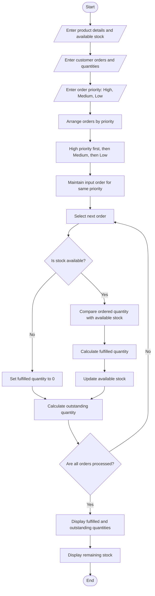

# Integrated Warehouse Order Prioritization

## 1. Problem Statement

Develop a Python program to manage and prioritize customer orders in a warehouse. The program should process product demand, available stock levels, order quantities, and priority categories. It must allocate stock to orders according to their priority, determine whether each order can be fully or partially fulfilled, and calculate outstanding quantities for unfulfilled orders.

Assumptions used:

- Each product has a fixed available stock.
- Orders are classified as High, Medium, or Low priority.
- High-priority orders are processed first, followed by Medium and Low.
- Orders with the same priority are processed in their input order.
- Stock cannot become negative.
- Outstanding quantity = Ordered quantity − Fulfilled quantity.

## 2. Algorithm

1. Start the program.
2. Input the number of products and their available stock levels.
3. Input the number of customer orders.
4. For each order, input the order ID, product name, quantity, and priority category.
5. Sort orders by priority: High, Medium, then Low.
6. Check whether the requested product exists in the warehouse.
7. Allocate available stock to each order, without exceeding the requested quantity.
8. Determine whether the order is fully fulfilled, partially fulfilled, or unfulfilled.
9. Calculate the outstanding quantity for every order.
10. Display the order fulfilment report and remaining stock.
11. Stop the program.

## 3. Flowchart (Mermaid TD)

## 4. Python Source Code

```
        fulfilled = min(requested, stock[product])        stock[product] -= fulfilled        if fulfilled == requested:            status = "Fully fulfilled"        elif fulfilled > 0:            status = "Partially fulfilled"        else:            status = "Unfulfilled"    outstanding = requested - fulfilled    report.append({        **order,        "fulfilled": fulfilled,        "outstanding": outstanding,        "status": status    })# Display fulfilment reportprint("\n===== ORDER FULFILMENT REPORT =====")for order in report:    print(f"\nOrder ID: {order['id']}")    print(f"Product: {order['product']}")    print(f"Priority: {order['priority']}")    print(f"Ordered quantity: {order['quantity']}")    print(f"Fulfilled quantity: {order['fulfilled']}")    print(f"Outstanding quantity: {order['outstanding']}")    print(f"Status: {order['status']}")# Display remaining stockprint("\n===== REMAINING WAREHOUSE STOCK =====")for product, quantity in stock.items():    print(f"{product}: {quantity} units")total_ordered = sum(o["quantity"] for o in report)total_fulfilled = sum(o["fulfilled"] for o in report)total_outstanding = sum(o["outstanding"] for o in report)print("\n===== SUMMARY =====")print("Total quantity ordered:", total_ordered)print("Total quantity fulfilled:", total_fulfilled)print("Total outstanding quantity:", total_outstanding)
```

## 5. Sample Input

```

Enter number of products: 2
Enter product name: Pen
Enter available stock: 10
Enter product name: Notebook
Enter available stock: 5

Enter number of orders: 4

Order 1
Enter order ID: O101
Enter product name: Pen
Enter order quantity: 7
Enter priority (High/Medium/Low): High

Order 2
Enter order ID: O102
Enter product name: Pen
Enter order quantity: 6
Enter priority (High/Medium/Low): Low

Order 3
Enter order ID: O103
Enter product name: Notebook
Enter order quantity: 8
Enter priority (High/Medium/Low): Medium

Order 4
Enter order ID: O104
Enter product name: Notebook
Enter order quantity: 3
Enter priority (High/Medium/Low): High

```

## 6. Sample Output

```

===== ORDER FULFILMENT REPORT =====

Order ID: O101
Product: Pen
Priority: High
Ordered quantity: 7
Fulfilled quantity: 7
Outstanding quantity: 0
Status: Fully fulfilled

Order ID: O104
Product: Notebook
Priority: High
Ordered quantity: 3
Fulfilled quantity: 3
Outstanding quantity: 0
Status: Fully fulfilled

Order ID: O103
Product: Notebook
Priority: Medium
Ordered quantity: 8
Fulfilled quantity: 2
Outstanding quantity: 6
Status: Partially fulfilled

Order ID: O102
Product: Pen
Priority: Low
Ordered quantity: 6
Fulfilled quantity: 3
Outstanding quantity: 3
Status: Partially fulfilled

===== REMAINING WAREHOUSE STOCK =====
Pen: 0 units
Notebook: 0 units

===== SUMMARY =====
Total quantity ordered: 24
Total quantity fulfilled: 15
Total outstanding quantity: 9

```

## 7. Result

The program prioritizes orders according to their priority categories, allocates available stock without exceeding inventory limits, and identifies fully fulfilled, partially fulfilled, and unfulfilled orders. It also calculates the outstanding quantities and displays the remaining warehouse stock.
