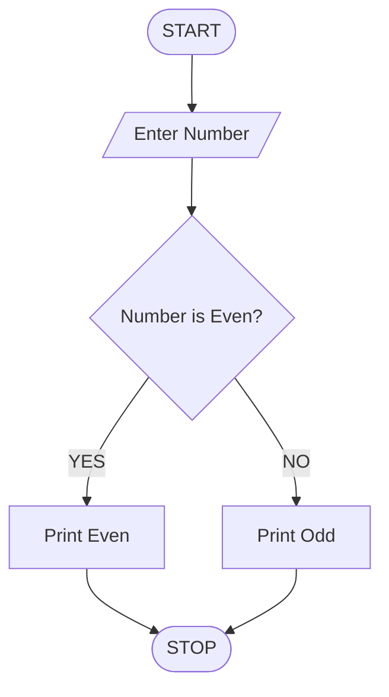

# Integrated Student Record Consistency Checker

## 1. Problem Statement

Develop a Python program to validate student academic records stored using lists and tuples. The program should check student identifiers, names, marks, attendance percentages, and course records. It must detect duplicate student IDs, missing values, invalid marks, invalid attendance, and inconsistent course information. Finally, the program should display valid records, list errors, and calculate the number of inconsistent records.

Assumptions used:

- Student IDs must be unique.
- Student names cannot be empty.
- Marks must be between 0 and 100.
- Attendance must be between 0% and 100%.
- Each student must have at least one valid course.
- Missing or invalid values are reported as errors.

## 2. Algorithm

1. Start the program.
2. Input the number of student records.
3. Read each student's ID, name, marks, attendance, and course details.
4. Store student records in lists and course records in tuples.
5. Check for duplicate student IDs.
6. Validate names and identify missing values.
7. Check that marks and attendance are within valid ranges.
8. Validate course records and identify missing or duplicate courses.
9. Store validation errors for each student.
10. Display student records, detected errors, and the final consistency summary.
11. Stop the program.

## 3. Flowchart (Mermaid TD)

## 4. Python Source Code

```
# Integrated Student Record Consistency Checkerstudents = []seen_ids = set()duplicate_ids = set()n = int(input("Enter number of students: "))if n <= 0:    print("Invalid number of students.")    raise SystemExitfor i in range(n):    print(f"\nStudent {i + 1}")    sid = input("Enter student ID: ").strip()    name = input("Enter student name: ").strip()    marks_input = input("Enter marks (0-100): ").strip()    attendance_input = input(        "Enter attendance percentage (0-100): "    ).strip()    courses_input = input(        "Enter courses separated by commas: "    ).strip()    errors = []    # Validate student ID    if not sid:        errors.append("Missing student ID")    elif sid in seen_ids:        duplicate_ids.add(sid)        errors.append("Duplicate student ID")    else:        seen_ids.add(sid)
```

## 5. Sample Input

```

Enter number of students: 3

Student 1
Enter student ID: S101
Enter student name: Ravi
Enter marks (0-100): 85
Enter attendance percentage (0-100): 90
Enter courses separated by commas: Python,Math

Student 2
Enter student ID: S101
Enter student name: Priya
Enter marks (0-100): 75
Enter attendance percentage (0-100): 80
Enter courses separated by commas: Python

Student 3
Enter student ID: S103
Enter student name:
Enter marks (0-100): 105
Enter attendance percentage (0-100): 0
Enter courses separated by commas:

```

## 6. Sample Output

```

===== STUDENT RECORD VALIDATION =====

Student ID: S101
Name: Ravi
Marks: 85.0
Attendance: 90.0
Courses: ('Python', 'Math')
Status: VALID

Student ID: S101
Name: Priya
Marks: 75.0
Attendance: 80.0
Courses: ('Python',)
Status: INCONSISTENT
- Duplicate student ID

Student ID: S103
Name: Missing
Marks: 105.0
Attendance: 0.0
Courses: ()
Status: INCONSISTENT
- Missing student name
- Marks must be between 0 and 100
- Missing course records
- Marks recorded despite zero attendance

===== CONSISTENCY SUMMARY =====
Total records: 3
Valid records: 1
Inconsistent records: 2
Duplicate student IDs: 1
Duplicate IDs found: S101

```

## 7. Result

The program successfully validates student identifiers, names, marks, attendance, and course records using Python lists and tuples. It detects duplicate IDs, missing values, invalid academic data, and inconsistent records, then generates a summary of valid and inconsistent student records.
