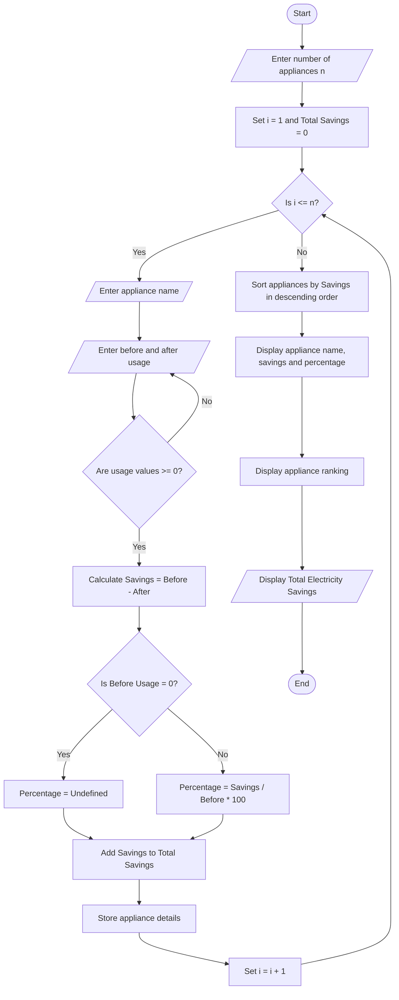

# Energy Conservation Before-and-After Analysis

## 1. Problem Statement

Develop a Python program to analyse electricity consumption of different appliances before and after an energy conservation intervention. The program should calculate energy savings, savings percentages, total electricity savings, and rank appliances according to the amount of electricity saved.

Assumptions used:

- Electricity usage is measured in kilowatt-hours (kWh).
- Savings = Before-intervention usage − After-intervention usage.
- Savings percentage = (Savings ÷ Before-intervention usage) × 100.
- Appliances are ranked from highest to lowest savings.
- If initial usage is zero, the savings percentage is reported as undefined.
- Negative savings indicate increased electricity consumption.

## 2. Algorithm

1. Start the program.
2. Input the number of appliances.
3. Enter each appliance name and its electricity usage before and after the intervention.
4. Validate that usage values are non-negative.
5. Calculate savings for each appliance.
6. Calculate the savings percentage.
7. Calculate total electricity usage before and after the intervention.
8. Calculate total energy savings and overall savings percentage.
9. Rank appliances by electricity savings in descending order.
10. Display the appliance-wise analysis and final ranking.
11. Stop the program.

## 3. Flowchart (Mermaid TD)


## 4. Python Source Code

```
# Energy Conservation Before-and-After Analysisappliances = []n = int(input("Enter number of appliances: "))if n <= 0:    print("Invalid number of appliances.")    raise SystemExitfor i in range(n):    print(f"\nAppliance {i + 1}")    name = input("Enter appliance name: ").strip()    before = float(input("Enter usage before intervention (kWh): "))    after = float(input("Enter usage after intervention (kWh): "))    if not name or before < 0 or after < 0:        print("Invalid name or usage value.")        raise SystemExit    savings = before - after    if before > 0:        percentage = (savings / before) * 100    else:        percentage = None    if savings > 0:        status = "Energy saved"    elif savings < 0:        status = "Consumption increased"    else:        status = "No change"
```

## 5. Sample Input

```

Enter number of appliances: 4

Appliance 1
Enter appliance name: Fan
Enter usage before intervention (kWh): 120
Enter usage after intervention (kWh): 80

Appliance 2
Enter appliance name: AC
Enter usage before intervention (kWh): 300
Enter usage after intervention (kWh): 210

Appliance 3
Enter appliance name: Lights
Enter usage before intervention (kWh): 100
Enter usage after intervention (kWh): 60

Appliance 4
Enter appliance name: Refrigerator
Enter usage before intervention (kWh): 150
Enter usage after intervention (kWh): 135

```

## 6. Sample Output

```

===== ENERGY CONSERVATION REPORT =====

Appliance: Fan
Before usage: 120.00 kWh
After usage: 80.00 kWh
Energy savings: 40.00 kWh
Savings percentage: 33.33%
Status: Energy saved

Appliance: AC
Before usage: 300.00 kWh
After usage: 210.00 kWh
Energy savings: 90.00 kWh
Savings percentage: 30.00%
Status: Energy saved

Appliance: Lights
Before usage: 100.00 kWh
After usage: 60.00 kWh
Energy savings: 40.00 kWh
Savings percentage: 40.00%
Status: Energy saved

Appliance: Refrigerator
Before usage: 150.00 kWh
After usage: 135.00 kWh
Energy savings: 15.00 kWh
Savings percentage: 10.00%
Status: Energy saved

===== APPLIANCE SAVINGS RANKING =====
1. AC - 90.00 kWh saved
2. Fan - 40.00 kWh saved
3. Lights - 40.00 kWh saved
4. Refrigerator - 15.00 kWh saved

===== OVERALL SUMMARY =====
Total before usage: 670.00 kWh
Total after usage: 485.00 kWh
Total energy savings: 185.00 kWh
Overall savings percentage: 27.61%
Overall result: Energy consumption reduced

```

## 7. Result

The program compares appliance-wise electricity usage before and after an intervention, calculates energy savings and savings percentages, and ranks appliances by achieved savings. In this example, the campus saves 185 kWh, achieving an overall electricity consumption reduction of 27.61%.
