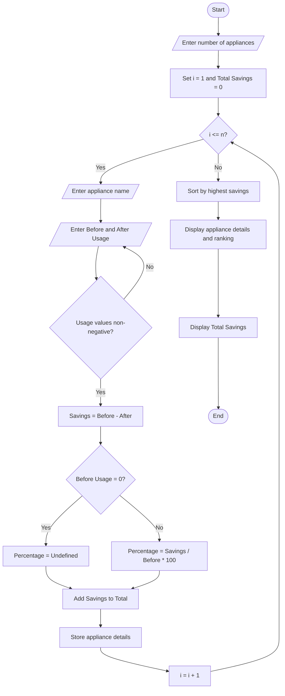

# Tuple-Based Course Registration Validation

## 1. Problem Statement

Develop a Python program to validate student course registrations represented as tuples. Each registration contains a student ID and a course name. The program should identify duplicate registrations, detect invalid course combinations based on predefined rules, and determine which students have violated registration requirements.

Assumptions used:

- Each registration is stored as a tuple: `(student_id, course_name)`.
- Available courses are Python, Mathematics, AI, and Web Development.
- A student cannot register for the same course more than once.
- Python and AI cannot be registered together.
- Mathematics and Web Development cannot be registered together.
- Course names must belong to the list of available courses.

## 2. Algorithm

1. Start the program.
2. Input the number of course registrations.
3. Read each student's ID and course name.
4. Store each registration as a tuple in a list.
5. Identify duplicate student-course registrations.
6. Check whether each course name is valid.
7. Group valid course selections by student.
8. Check the specified invalid course combinations.
9. Identify students who violate one or more rules.
10. Display duplicate registrations, invalid courses, rule violations, and the final summary.
11. Stop the program.

## 3. Flowchart (Mermaid TD)

# Energy Conservation Before-and-After Analysis




## 4. Python Source Code

```
# Tuple-Based Course Registration Validationvalid_courses = {    "Python",    "Mathematics",    "AI",    "Web Development"}# Each forbidden pair is a frozensetinvalid_combinations = [    frozenset(("Python", "AI")),    frozenset(("Mathematics", "Web Development"))]registrations = []seen_registrations = set()duplicate_registrations = []invalid_courses_found = []student_courses = {}violations = {}n = int(input("Enter number of registrations: "))if n < 0:    print("Invalid number of registrations.")    raise SystemExit# Input registrations as tuplesfor i in range(n):    print(f"\nRegistration {i + 1}")    student_id = input("Enter student ID: ").strip()    course = input("Enter course name: ").strip()
```

## 5. Sample Input

```

Enter number of registrations: 7

Registration 1
Enter student ID: S101
Enter course name: Python

Registration 2
Enter student ID: S101
Enter course name: AI

Registration 3
Enter student ID: S102
Enter course name: Mathematics

Registration 4
Enter student ID: S102
Enter course name: Web Development

Registration 5
Enter student ID: S103
Enter course name: Python

Registration 6
Enter student ID: S103
Enter course name: Python

Registration 7
Enter student ID: S104
Enter course name: Biology

```

## 6. Sample Output

```

===== REGISTRATION RECORDS =====
('S101', 'Python')
('S101', 'AI')
('S102', 'Mathematics')
('S102', 'Web Development')
('S103', 'Python')
('S103', 'Python')
('S104', 'Biology')

===== DUPLICATE REGISTRATIONS =====
('S103', 'Python')

===== INVALID COURSES =====
('S104', 'Biology')

===== STUDENT VALIDATION REPORT =====

Student ID: S103
- Duplicate registration: Python

Student ID: S101
- Invalid combination: AI and Python

Student ID: S102
- Invalid combination: Mathematics and Web Development

Student ID: S104
- Invalid course: Biology

===== SUMMARY =====
Total registrations: 7
Duplicate registrations: 1
Invalid course records: 1
Students with violations: 4

```

## 7. Result

The program uses tuples to store course registrations and validates them against the specified rules. It detects duplicate registrations, invalid course names, and prohibited course combinations, then identifies students whose selections violate the registration rules.
