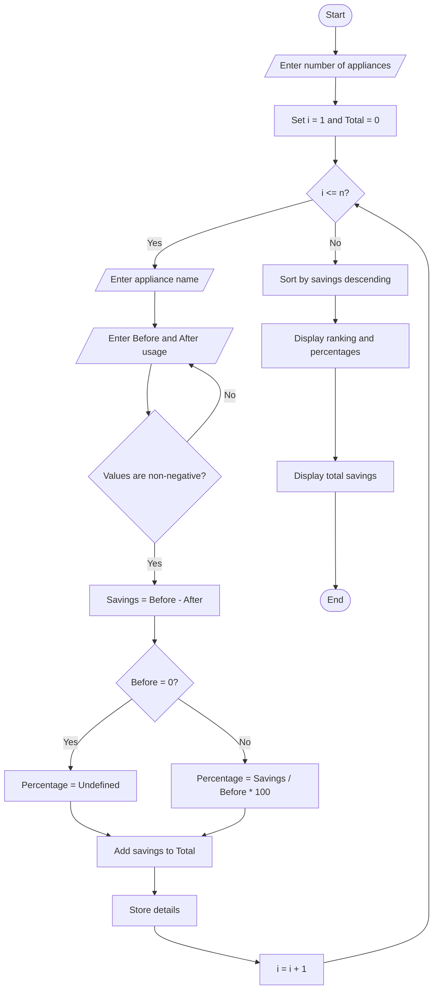

# Manufacturing Quality Control Matrix – Python Project

## 1. Problem Statement

Develop a Python program to analyse production quantities and defective units across multiple products and batches using a matrix (nested list). The program must calculate the defect percentage for each batch, compare it with a specified quality threshold, identify batches that exceed the threshold, and display a final quality control report.

Assumptions:

- Each batch contains the production quantity and number of defective units.
- Defective units cannot exceed the production quantity.
- The quality threshold is 5%.
- A batch is marked Needs Inspection if its defect percentage is greater than 5%; otherwise, it is marked Acceptable.

## 2. Algorithm

1. Start the program.
2. Input the number of products and batches.
3. Input the product name, production quantity, and defective units for each batch.
4. Store the batch data in a nested list.
5. Calculate the defect percentage using:

\\[ \text{Defect Percentage}= \frac{\text{Defective Units}}{\text{Production Quantity}}\times100 \\]

6. Compare each batch's defect percentage with the quality threshold.
7. Identify batches exceeding the threshold.
8. Display the quality control report and summary.
9. Stop the program.

## 3. Flow chart (mermaid TD)




## 4. Python Source Code

```
    for j in range(batches_count):        print(f"Batch {j + 1}")        quantity = int(input("Enter production quantity: "))        defective = int(input("Enter defective units: "))        if quantity <= 0 or defective < 0 or defective > quantity:            print("Invalid production or defective quantity.")            raise SystemExit        batches.append([quantity, defective])    products.append([product_name, batches])print("\n======= QUALITY CONTROL REPORT =======")print("Threshold:", quality_threshold, "%")inspection_count = 0total_produced = 0total_defective = 0for product in products:    product_name = product[0]    batches = product[1]    print(f"\nProduct: {product_name}")    for i, batch in enumerate(batches, start=1):        quantity = batch[0]        defective = batch[1]        defect_percentage = defective / quantity * 100        total_produced += quantity        total_defective += defective        if defect_percentage > quality_threshold:            status = "Needs Inspection"            inspection_count += 1        else:            status = "Acceptable"        print(            f"Batch {i}: Produced={quantity}, "            f"Defective={defective}, "            f"Defect={defect_percentage:.2f}%, "            f"Status={status}"        )print("\n======= OVERALL SUMMARY =======")print("Total production:", total_produced)print("Total defective units:", total_defective)if total_produced > 0:    overall_percentage = total_defective / total_produced * 100    print(f"Overall defect percentage: {overall_percentage:.2f}%")print("Batches needing inspection:", inspection_count)
```

## 5. Sample Input

```

Enter number of products: 2

Enter product name: Laptop
Enter number of batches: 2
Batch 1
Enter production quantity: 100
Enter defective units: 3
Batch 2
Enter production quantity: 200
Enter defective units: 15

Enter product name: Keyboard
Enter number of batches: 2
Batch 1
Enter production quantity: 150
Enter defective units: 12
Batch 2
Enter production quantity: 100
Enter defective units: 2

```

## 6. Sample Output

```

======= QUALITY CONTROL REPORT =======
Threshold: 5.0 %

Product: Laptop
Batch 1: Produced=100, Defective=3, Defect=3.00%, Status=Acceptable
Batch 2: Produced=200, Defective=15, Defect=7.50%, Status=Needs Inspection

Product: Keyboard
Batch 1: Produced=150, Defective=12, Defect=8.00%, Status=Needs Inspection
Batch 2: Produced=100, Defective=2, Defect=2.00%, Status=Acceptable

======= OVERALL SUMMARY =======
Total production: 550
Total defective units: 32
Overall defect percentage: 5.82%
Batches needing inspection: 2

```

## 7. Result

The Python program successfully stores production data in nested lists, calculates defect percentages for each batch, identifies batches exceeding the 5% quality threshold, and displays the overall manufacturing quality report.
