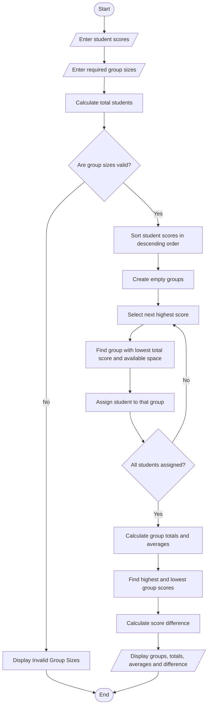

# Student Group Formation with Score Balancing – Python Project

## 1. Problem Statement

Develop a Python program to divide students into groups of specified sizes using a list of student scores. The program should allocate students so that the total scores of the groups are as balanced as possible. It must follow the given group sizes, avoid assigning a student more than once, calculate each group's total and average score, and display the difference between the highest and lowest group totals.

Allocation rules:

- Each student has a unique ID and a score.
- The group sizes are provided by the user.
- Every student must be allocated exactly once.
- Students are assigned using a greedy balancing method: process students from highest score to lowest and assign each student to the eligible group with the lowest current total score.
- If group totals are equal, choose the first eligible group.
- Group sizes must add up to the total number of students.

## 2. Algorithm

1. Start the program.
2. Input the number of students.
3. Input each student's score and store the scores in a list.
4. Input the number of groups and the required size of each group.
5. Check whether the sum of group sizes equals the number of students.
6. Sort students by score in descending order.
7. For each student, find the group with the lowest total score that has available space.
8. Assign the student to that group and update its total score.
9. Repeat until all students are allocated.
10. Display the students, group totals, average scores, and difference between the highest and lowest group totals.
11. Stop the program.

## 3. Flowchart



## 5. Sample Input

```

Enter number of students: 6
Enter score of student 1: 90
Enter score of student 2: 80
Enter score of student 3: 70
Enter score of student 4: 60
Enter score of student 5: 50
Enter score of student 6: 40
Enter number of groups: 2
Enter size of group 1: 3
Enter size of group 2: 3

```

## 6. Sample Output

```

===== STUDENT GROUP ALLOCATION =====

Group 1:
S1: 90
S4: 60
S5: 50
Group Total: 200
Group Average: 66.67

Group 2:
S2: 80
S3: 70
S6: 40
Group Total: 190
Group Average: 63.33

===== SUMMARY =====
Highest Group Total: 200
Lowest Group Total: 190
Difference Between Totals: 10

```

## 7. Result

The program successfully allocates students into groups of specified sizes using a greedy score-balancing method. It calculates group totals and averages and reports the difference between the highest and lowest group totals.

Note: This greedy method aims to balance scores efficiently, but it does not guarantee the mathematically optimal allocation in every case.
